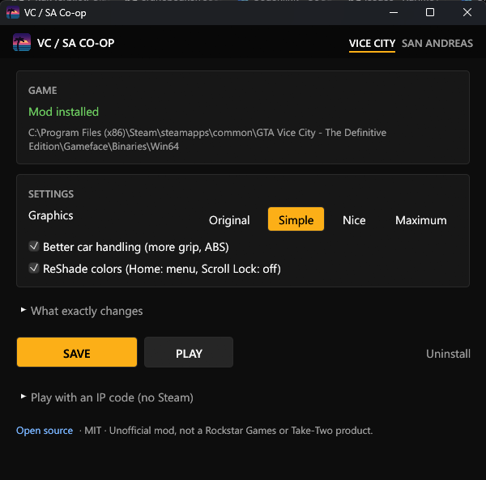

  

<h1 align="center">VC / SA Co-op</h1>

  <b>Play GTA Vice City together, online.</b> 
  A co-op mod for <b>GTA Vice City: The Definitive Edition</b> and <b>GTA San Andreas: The Definitive Edition</b> (PC, Steam).
  Each player on their own PC, with their own copy of the game.

  
  
  
  
  

  <a href="https://github.com/P1tak4s/vc-sa-coop/releases/latest"><b>Download</b></a> ·
  <a href="#quick-start">Quick start</a> ·
  <a href="#features">Features</a> ·
  <a href="#what-is-tested">What is tested</a> ·
  <a href="#faq">FAQ</a> ·
  <a href="#build-from-source">Build</a>

---

VC / SA Co-op adds a **CO-OP** option to the game's own menu. One player creates a session with a name and a
password, the other joins with the same two words, and you play in one world: your friend walks, drives and fights
next to you, rides in your car, and the host's missions, mission text and map markers reach both players. Sessions
run through Steam lobbies, so there are no servers to rent and no ports to open.

It is the Vice City port of [SA Co-op](https://github.com/P1tak4s/sa-de-coop): one `coopnet64.asi` that knows both
games, one app that installs into either.

  

> [!NOTE]
> **Early test build.** Vice City has been tested on one PC with an AI test partner (see
> [What is tested](#what-is-tested)). A full session between two players over Steam has not been done yet, so expect
> rough edges. Bug reports are very welcome in [Issues](https://github.com/P1tak4s/vc-sa-coop/issues).

## Quick start

1. **Download** `VC-SA-Coop-<version>-windows-x64.zip` from [Releases](https://github.com/P1tak4s/vc-sa-coop/releases) and unpack it.
2. Close the game and **run `VC-SA-Coop.exe`**. It finds Vice City (and San Andreas) in your Steam libraries.
   Pick the options, click **INSTALL**, then **PLAY**.
3. Load a save, press **ESC → CO-OP**. One of you **creates** a session, the other **joins** with the same name and password.

Your friend does the same on their PC.

## Features

| | |
| --- | --- |
| **Co-op from the menu** | A **CO-OP** entry in the main and pause menus (and **F9** anywhere). Sessions are Steam lobbies found by name and password, no port forwarding. An IP-code mode without Steam is in the app. |
| **Together in the world** | Your friend walks, runs and drives in your Vice City with their weapon, a name tag and a map blip; interiors are respected. Clock, weather and wanted level are shared. |
| **One story for both** | The host plays the story and the guest joins it; the guest can still play and save its own missions. The host's mission starts once the partner stands in the marker. Mission text and destination markers reach the guest; a friend's cutscene is announced. |
| **Ride along** | **G** puts you in a free seat of your friend's car. When it is full (a two-seater on a mission, a bike with two) you ride on the trunk facing back, or behind the rider, and can still shoot. **F** gets you out. |
| **Down, not dead** | Below 40 health you go down instead of dying. A 30-second countdown appears and your friend holds **E** to get you up. |
| **Retry together** | A failed mission offers **R**: both players go back to where the mission began. |
| **AI test partner** | `tools/testbotas.py` joins as a friend, runs test phases and writes a report of what the game showed; with your own OpenAI key it then plays as a partner (follows, rides along, fights mission enemies). |
| **Better graphics** | Original / Simple / Nice / Maximum: longer view distance, ambient occlusion, reflections, sharper shadows, through the game's own `CustomSettings.ini` and `Engine.ini`. Optional ReShade look (the official ReShade 6.8.0, our own small colour shader). |
| **Better car handling** | Optional: more grip, ABS, stronger brakes, firmer suspension, a lower centre of mass, built from your own game's `handling.cfg`. |
| **Clean uninstall** | The app shows what it changes and removes everything it added. No admin rights needed. |

**Not in Vice City (the game has no way to do it from a script):** your friend's shots are not drawn, a friend's
cutscene is not replayed for you, story characters (Ken, Sonny...) cannot be picked as looks.

## What is tested

Tested on 2026-11-08, Steam build 1.0.113.49697469, one PC, an AI test partner over the in-game test host:

| Works | Built, not tried in game yet |
| --- | --- |
| Install, menu **CO-OP** entry, hooks report OK | **G** into a friend's car, trunk / bike seat |
| Friend appears, follows, map blip, weapon | **E** revive, interiors, **R** retry |
| Friend rides in your car, you keep driving | AI partner fighting mission enemies |
| Mission name, cutscene, mission text, weather reach the partner | Names over heads, walking smoothness (just reworked) |
| | Graphics presets, handling, ReShade together with the co-op window |
| | Two real players over Steam |

## Requirements

- A **legally owned** copy of GTA Vice City and/or San Andreas: The Definitive Edition on **Steam**, game build
  **1.0.113.49697469**. The mod reads game memory at fixed addresses for this build; other builds switch those
  parts off (the game still runs).
- Windows 10 or 11 (64-bit).
- For co-op, your friend needs their own PC and their own Steam copy. Pirated copies are not supported.

## FAQ

**Is it safe to run?**
All of the source is in this repository and the release is built from it. The app is a plain exe next to its files:
it copies files, it does not unpack or start hidden programs, and it never asks for admin rights. It shows exactly
what it changes and has an **Uninstall** button. Windows SmartScreen may warn because the exe is not code-signed
(certificates are paid): click **More info → Run anyway**, or build it yourself.

**Does it ship any Rockstar files?**
No. The menu entry and the car handling are built on your PC from your own copy of the game. The game art in the
app's header is read from your own Steam library cache, the way Steam shows it.

**Can I get banned?**
The Definitive Edition has no online mode or anti-cheat, and the mod does not touch Rockstar's services.

**Will it mess up my saves?**
Co-op games are saved apart from your own story, and your saves are copied to `%LOCALAPPDATA%\vc-de-coop\saves-backup`
before anything is switched.

**San Andreas?**
The same app installs into San Andreas too. Active San Andreas work happens in
[sa-de-coop](https://github.com/P1tak4s/sa-de-coop); this repository follows it.

## Troubleshooting

- **The game crashes when a friend appears**: make sure you run the version from Releases; early builds loaded story
  characters, which the Definitive Edition does not allow from a script.
- **No CO-OP in the menu**: run the app again and click **SAVE**; the menu entry is rebuilt from your game files.
  **F9** opens the co-op window anyway.
- **Logs**: `%LOCALAPPDATA%\vc-de-coop\coopnet.log` and `...\Gameface\Binaries\Win64\cleo_redux.log`.

## How it works

| Part | What it does |
| --- | --- |
| `proto/` | wire format (80-byte player state, events, join code) |
| `relay/` | UDP relay for the IP mode, UPnP |
| `coopnet/` | `coopnet64.asi`: networking (Steam lobbies + P2P, or UDP), the in-game co-op window (hudhook / Dear ImGui), menu hook (`UObject::ProcessEvent`), story hooks (the script engine's opcode handlers), the Vice City passenger warp. `game.rs` holds what differs between the two games. |
| `game/CLEO/` | CLEO Redux scripts: `vc-coop.js` for Vice City, `sa-coop.js` (+ AI partner) for San Andreas |
| `launcher/` | `VC-SA-Coop.exe`: install, settings, uninstall, IP mode; graphics presets, handling, ReShade |
| `menu-mod/tool/` | MenuPatch (UAssetAPI): adds the CO-OP entry to the game's menu templates |
| `tools/` | `make_release.py`, `dll_test.py` (loopback test), `testbotas.py` (AI test partner) |
| `docs/VICE-CITY-PLANAS.md` | the port plan and the reverse-engineered Vice City addresses |

## Build from source

- Rust stable (MSVC) and the Windows SDK: `cargo build --release`
- MenuPatch: .NET 8, `dotnet publish -c Release -r win-x64 --self-contained -p:PublishSingleFile=true`
- `python -I tools/make_release.py` puts the package together (`dist/VC-SA-Coop-<version>.zip`); the third-party
  tools in `extra/` (repak, MenuPatch, ReShade) are not in git.

## Credits

[CLEO Redux](https://re.cleo.li) by Seemann, [Ultimate ASI Loader](https://github.com/ThirteenAG/Ultimate-ASI-Loader)
by ThirteenAG, [hudhook](https://github.com/veeenu/hudhook), [repak](https://github.com/trumank/repak),
[UAssetAPI](https://github.com/atenfyr/UAssetAPI), [ReShade](https://reshade.me) by crosire. Ideas from
[SA:COOP](https://github.com/Karimov-Akbar/sa-coop) for the classic game.

Not affiliated with Rockstar Games or Take-Two Interactive. Grand Theft Auto and Vice City are their trademarks.
Licence: [MIT](LICENSE).
